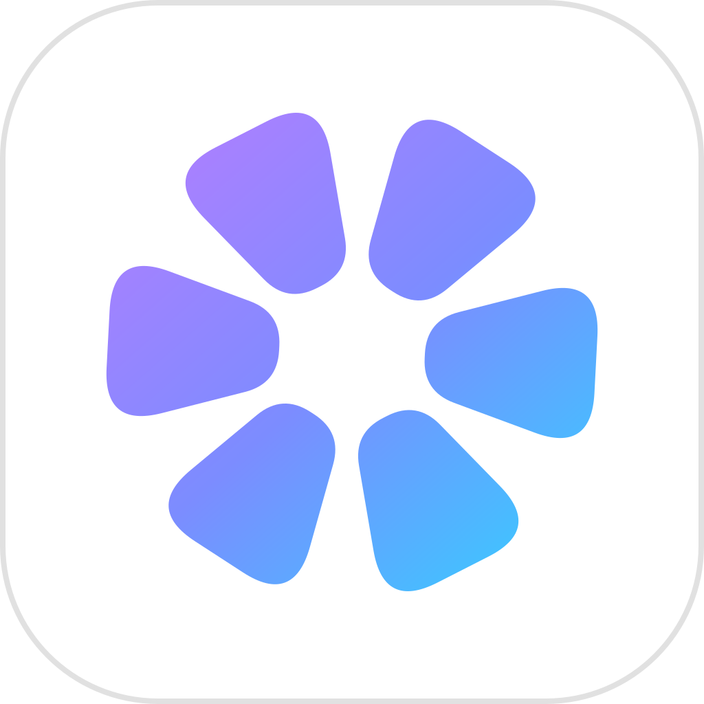

<p align="center">
  
</p>

<h1 align="center">Jellypic</h1>

<p align="center">
  An iPhone app for the photos on your own Jellyfin server: browse the library the way
  the Photos app shows your camera roll, and back the iPhone's photos up to it.
</p>

<p align="center">
  iOS 12.2+ · Jellyfin 10.11 · <a href="PRIVACY.md">Privacy</a> · <a href="LICENSE">MIT licence</a>
</p>

<p align="center">
  <sub>An independent project, not made or endorsed by the Jellyfin project.</sub>
</p>

## What it does

**Browsing**

- One timeline of a Jellyfin photo library, sorted by when each photo was taken, with month
  sections and a scrubber. The library is indexed on the device, so the grid stays fast on
  libraries of tens of thousands of photos, and on a 1 GB iPhone 5s.
- A viewer with pinch to zoom, the photo's details (camera, exposure, location), and sharing
  of either the optimised image or the original file.
- Videos: played directly when the iPhone can decode them, converted by the server when it
  cannot, with a note saying so before you tap play.
- A map of every photo that carries a location.
- Deleting a photo from the server, when your Jellyfin account is allowed to. Videos are
  left out: in a photo library, Jellyfin's own delete can remove far more than the video
  ([docs/15](docs/15-delete-from-server.md) §6).

**Backing up**

- Off, Manual or Automatic. Manual sends the photos you pick; Automatic sends new photos in
  the background, even with the app closed, and offers to send the ones already on the
  phone.
- Originals are sent byte for byte: a HEIC stays a HEIC, and an edited photo is sent as you
  see it in Photos. Each photo is identified by the SHA-256 of its bytes, so nothing is sent
  twice.
- Wi-Fi only. Videos are not backed up yet.

## Requirements

- An iPhone running **iOS 12.2** or later. TestFlight builds require iOS 15.
- **Jellyfin 10.11**, with a *Home Videos and Photos* library.
- Two optional server plugins, by the same author:
  - [HEIC for Jelly](https://github.com/RousseAddict/heic-for-jelly) — Jellyfin does not
    show HEIC photos on its own, and every iPhone photo is a HEIC.
  - [Upload for Jelly](https://github.com/RousseAddict/upload-for-jelly) — required for
    backing up. Jellyfin has no way to add a file to a library over HTTP without it.

## Privacy

Jellypic talks to your server and nothing else, apart from Apple's map tiles and, when you
open it, this privacy policy on GitHub: no account of ours, no analytics, no third-party
code. The session token is kept in the
Keychain and your password is never stored. Access to your photo library is asked for only
when you turn backup on, and a limited selection is honoured — backup is then manual only.
The full policy is in [PRIVACY.md](PRIVACY.md).

## Building

The project has **no third-party dependencies**: UIKit, Core Data and `URLSession` only, and
a hand-written Xcode project with a shared scheme.

```sh
./build.sh                          # builds an ad-hoc signed IPA
CONFIGURATION=Release ./build.sh    # release build
BUILD_HOST= ./build.sh              # build on this machine instead of over ssh
```

Every setting is an environment variable, documented at the top of `build.sh`. No
credential lives in the repository: a build machine's password, if one is needed, comes
from the environment or from a git-ignored `.env.local`.

GitHub Actions builds every push to `main` on `macos-26`; signing and the TestFlight upload
are manual, separate steps (`.github/workflows/build.yml`).

## Documentation

`docs/` records why the app is built the way it is, one subject per file:

| | |
|---|---|
| [01](docs/01-storage-and-upload-research.md) | storage layout and upload research |
| [02](docs/02-reader-app-plan.md) | the browsing app's plan |
| [03](docs/03-xcode-project.md) | the Xcode project, CI and App Store packaging |
| [04](docs/04-network-and-auth.md) | the Jellyfin client and sign-in |
| [05](docs/05-design-system-and-connect-flow.md) | the design system and the connect flow |
| [06](docs/06-index-and-sync.md) | the on-device index and sync |
| [07](docs/07-grid-and-images.md) | the grid and the image pipeline |
| [08](docs/08-viewer.md) | the photo viewer |
| [09](docs/09-settings-and-maintenance.md) | settings and maintenance |
| [10](docs/10-video.md) | video |
| [11](docs/11-writer-upload-contract.md) | the upload contract shared with the plugin |
| [12](docs/12-writer-app-plan.md) | backup |
| [13](docs/13-app-review-notes.md) | App Store review notes |
| [14](docs/14-testflight-setup.md) | TestFlight setup |
| [15](docs/15-delete-from-server.md) | deleting from the server |
| [16](docs/16-circles-and-capsules.md) | buttons, pills and touch areas |
| [17](docs/17-connect-icon-card.md) | the connect card |

## Licence

MIT. See [LICENSE](LICENSE).
